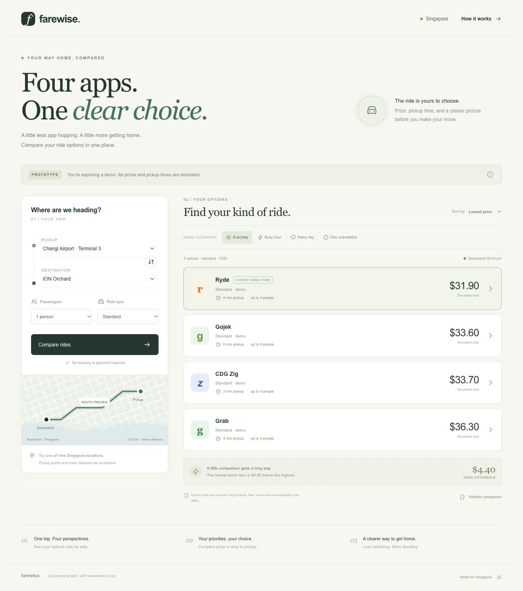
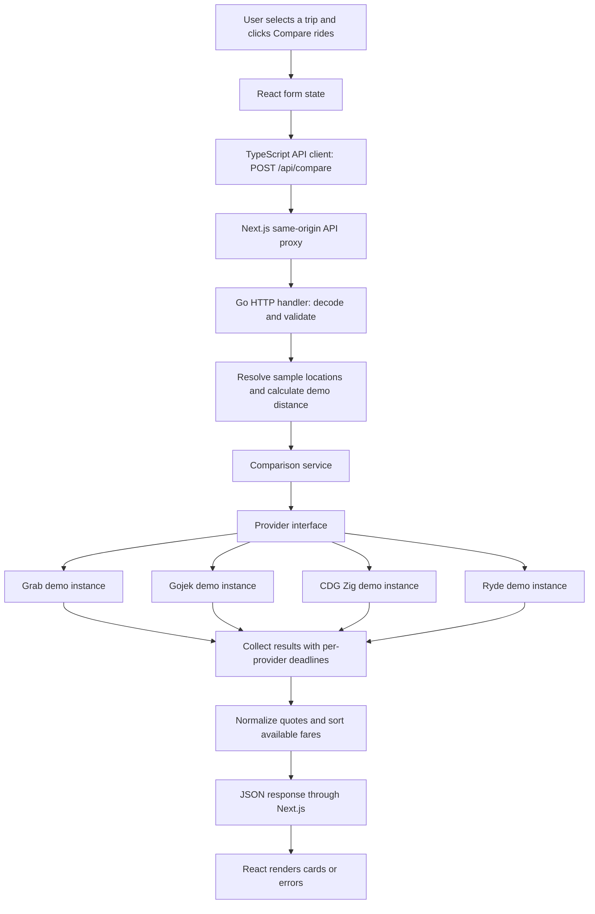

# Farewise

[](https://github.com/Raghaaavvv/farewise/actions/workflows/ci.yml)

**A Singapore ride comparison prototype built with Go, Next.js and TypeScript.**

Farewise started with a familiar problem: after landing at the airport, finding a ride home meant switching between Grab, Gojek, CDG Zig and Ryde to compare their prices. The intended app brings comparable ride options into one screen so a user can choose based on fare, pickup time and vehicle capacity.

The current prototype demonstrates the complete frontend-to-backend comparison flow using simulated providers. **Every fare, pickup estimate and availability result is invented. No provider servers are contacted, and the app cannot book rides.** A working comparison interface does not yet mean that live fare access has been solved.



[View the iPhone layout](docs/images/iphone.jpg)

## What works today

- Compare four configured demo providers: Grab, Gojek, CDG Zig and Ryde.
- Choose pickup and destination from nine sample Singapore locations, or swap them.
- Select one to six passengers and standard or six-seater vehicles. More than four passengers automatically selects a six-seater.
- Sort results by the lowest fare or soonest pickup.
- Explore everyday, busy-hour, rainy-day and provider-failure scenarios.
- See loading states, validation errors, retry controls, quote details and expiration notices.
- Keep healthy results visible when one provider is unavailable or times out.
- Use a responsive interface on desktop or iPhone.

Prices are deterministic for the same inputs; refreshing updates their timestamps rather than pretending to observe a real price change. Demo comparisons expire after two minutes. All vehicles and service labels are illustrative, rather than verified provider products.

## Languages, frameworks and tools

| Technology | Role in the project |
| --- | --- |
| **Go** | Backend domain models, HTTP API, comparison service, concurrency and tests |
| **Go `net/http`** | Method-based routing, request decoding, response handling and server lifecycle; no external Go web framework |
| **Next.js 16.4** | React App Router frontend and a same-origin proxy to the Go API |
| **React** | Components, form state, asynchronous comparison state and interactive results |
| **TypeScript** | Typed requests, responses, locations, quotes and UI state |
| **HTML, CSS and SVG** | Semantic controls, responsive layouts, icons and an illustrative route graphic |
| **pnpm** | Frontend dependency management and reproducible lockfile-based installs |
| **Prettier** | Frontend source formatting |
| **Go `testing` / `httptest`** | Unit and HTTP handler tests without external test dependencies |
| **GitHub Actions** | Automatic Go checks, TypeScript checks and production frontend builds |
| **VS Code** | Workspace, recommended extensions, run tasks and a Go debugging configuration |

There is no database, login system, external geocoder or live provider integration in this version. Next.js forwards requests; the comparison business logic lives in Go.

## Architecture and request pipeline



The adapters run concurrently using goroutines. Each has an independent timeout, so a slow or failed adapter produces an unavailable result while the others remain usable. Real adapters will need to honor cancellation in their HTTP requests; an aggregation deadline alone cannot stop an implementation that ignores its context.

### How buttons reach the backend

| UI action | What happens |
| --- | --- |
| Initial page load | Fetches `GET /api/locations`, then sends the default trip to `POST /api/compare` |
| **Compare rides** | Prevents the normal form submission, captures the current trip, sends JSON, displays loading placeholders, then replaces results |
| **Refresh comparison** or **Retry** | Calls the same comparison function with current form values |
| Change route, passengers, ride type or scenario | Updates local state; previous results remain visible with a notice until comparison is requested again |
| Change sort order | Reorders the existing response in the browser; does not make another provider request |
| Open quote details | Displays a dialog using fields already returned by the backend |

`AbortController` cancels superseded browser requests. The UI only processes a completion if its controller has not been aborted, preventing a previous trip's response from replacing a newer comparison. Canceling a browser request does not guarantee that an upstream request has already been stopped.

The browser requests relative `/api/...` URLs. Next.js rewrites them to the Go server, avoiding the need for a separate browser-facing API origin during development.

## Software engineering skills demonstrated

### Domain modeling and object-oriented concepts in Go

Go uses **structs, methods and interfaces** rather than Java-style classes and inheritance. This project demonstrates encapsulation, abstraction, polymorphism and composition using those Go mechanisms.

| Model | Relevant fields and responsibility |
| --- | --- |
| `Location` | ID, name, description, latitude and longitude |
| `Request` | Pickup/destination IDs, passenger count, vehicle type and demo scenario |
| `Trip` | Resolved location objects, passenger count, vehicle type, scenario and demo distance |
| `Quote` | Provider identity, service, status, currency, fare, ETA, source, timestamp and capacity |
| `Comparison` | Trip, collection of quotes, demo notice, collection time and expiry |
| `Service` | Encapsulates the injected providers and their timeout; coordinates comparison |
| `DemoProvider` | Holds a provider's demo configuration and implements estimation behavior |

Prices use **integer cents** to avoid binary floating-point arithmetic for money. Optional amounts and ETAs use pointers in Go and `number | null` in TypeScript. A missing quote is represented as `null`, never as a zero-dollar ride.

### Provider abstraction and dependency injection

```go
type Provider interface {
    ID() string
    Name() string
    Estimate(context.Context, Trip) (Quote, error)
}
```

The current application creates **four differently configured instances of one `DemoProvider` type**. They implement this interface and return a shared `Quote` shape. They simulate fetching details; they do not fetch real app data.

`NewService(providers, timeout)` injects these dependencies. The service knows the interface rather than depending on the concrete implementation. Tests can therefore substitute a slow fake provider. A future permitted integration can implement the same interface with provider-specific authentication, requests and response normalization.

This uses composition and an adapter-style boundary. It does not currently contain four independently reverse-engineered provider classes.

### Separation of concerns and asynchronous programming

- **HTTP layer:** routes, JSON decoding, payload limits, validation failures and response encoding.
- **Domain layer:** location, request, trip and quote models.
- **Comparison service:** concurrency, deadlines, partial failures and result ordering.
- **Provider layer:** estimation behavior behind a shared interface.
- **Frontend API client:** typed transport functions and error propagation.
- **UI layer:** interaction, loading states, sorting, dialogs and responsive presentation.

Other skills exercised include REST API design, JSON serialization, React hooks, dependency injection, race-aware concurrent programming, request cancellation, Git workflows and continuous integration. The TypeScript types describe the expected API contract; the client currently does not perform runtime schema validation of arbitrary responses.

## Coordinates and the Haversine calculation

**Haversine calculates distance between two known coordinate pairs. It does not retrieve a location or read coordinates from another app.**

Today, `FindLocation(id)` retrieves an entry from the in-memory demo catalog. Each entry already includes approximate latitude and longitude. The backend then converts degrees to radians and calculates the great-circle distance between pickup and destination using a spherical Earth radius of 6,371 km:

```text
a = sin²(Δlatitude / 2)
    + cos(latitude1) × cos(latitude2) × sin²(Δlongitude / 2)

distance = 2 × 6371 × atan2(√a, √(1 − a))
```

The prototype multiplies that distance by **1.25** and rounds it to one decimal place as an illustrative road-distance approximation. This factor is invented. It does not account for real roads, traffic, closures, terminal pickup arrangements or the provider's route.

Real location acquisition, address lookup and road routing are separate future features:

- **Device geolocation:** obtains the user's coordinates with permission.
- **Geocoding:** converts an address or selected place into coordinates.
- **Reverse geocoding:** converts coordinates into an address or place description.
- **Routing:** calculates a traversable road route and driving distance.

The map graphic is decorative, not a navigable map.

## Error handling and reliability

| Situation | Current behavior |
| --- | --- |
| Malformed JSON, extra fields or multiple JSON objects | HTTP 400 with an error message |
| Unknown location or identical pickup/destination | Validation failure; HTTP 400 |
| Invalid passenger count or incompatible vehicle capacity | Validation failure; the UI also selects a six-seater for more than four passengers |
| Unknown demo scenario | HTTP 400 |
| Provider returns an error, times out or returns missing/invalid fare fields | An unavailable quote is returned; healthy provider quotes are preserved |
| API returns an error | Frontend displays the message and a retry control |
| API response cannot be parsed as JSON | Frontend displays a service-unavailable message |
| Network failure | The frontend catches the rejected request and displays an error |
| Old request completes after a new request starts | Aborted request completions are ignored by the UI |
| Trip changes after comparison | Results remain associated with the previous submitted trip and an update notice appears |
| Demo expiry passes | UI marks the quotes expired and offers refresh; the backend does not enforce expiry at booking because booking is not implemented |

The backend limits comparison bodies to 4 KB, applies server read/write timeouts, sends `Cache-Control: no-store`, and supports graceful shutdown. Unavailable results are sorted after available prices. These measures are not a replacement for production authentication, rate limiting or monitoring.

## Automated tests and continuous integration

The Go tests cover:

| Test | What it checks |
| --- | --- |
| `TestComparePartialFailureAndOrdering` | A failing Ryde adapter leaves all four result entries present, available fares stay sorted, and the missing fare remains null |
| `TestInvalidTrips` | Rejects identical locations, five passengers in a standard vehicle, unknown locations, unexpected fields and multiple JSON objects |
| `TestTimeoutKeepsOtherProviderResult` | A timed-out provider does not discard a healthy provider's quote |
| `TestHaversineDistance` | Identical points give zero distance, one degree along the equator gives approximately 111.195 km, and distance is symmetric |

Run all local checks:

```sh
bash scripts/check.sh
```

This runs Go tests with the race detector, `go vet`, TypeScript checks and a production Next.js build. GitHub Actions runs the equivalent checks on pushes and pull requests. The Go workflow checks both the supported minimum version and the current development version.

TypeScript checking and a production build are static/build checks, not frontend behavioral tests. Sorting, the quote dialog, six-seater selection, provider-failure display and a 390-pixel mobile layout were also checked manually in the browser. Browser automation tests are a future improvement.

## Challenges and problems identified so far

### 1. Obtaining each provider's live price

The main unresolved problem is obtaining permitted, reliable live fare data for all four providers. A route-distance formula cannot reproduce demand-based prices, personal promotions, vehicle availability or provider-specific fees.

Grab publishes a [Farefeed API](https://developer.grab.com/products/farefeed-api) for selected partners, with [documented fare estimates](https://developer.grab.com/docs/partner-farefeed/). Access and Singapore coverage for this project still need confirmation. Ryde's [published merchant API](https://developer.ryde.io/) covers RydeSEND deliveries, which does not establish passenger fare access. No self-service Singapore passenger-fare API was verified for Gojek or CDG Zig during the initial research.

**Current decision:** develop the comparison flow with transparent simulated adapters, then replace them when suitable access is available. Future quote models must support fare ranges, account-specific pricing, inclusions, source and provider expiry before displaying real data.

### 2. Obtaining location and other attributes

Permission to access the user's device location is different from permission to access data inside a ride-hailing app. The prototype currently requests neither: locations come from a fixed sample catalog.

A future **Use my location** control should request device geolocation only when the user chooses it, handle denial or timeout, and preserve manual selection. Browser geolocation requires user permission and a secure context, normally HTTPS. A phone visiting the current plain-HTTP LAN development URL should not be assumed to support that future feature. See [MDN's Geolocation API documentation](https://developer.mozilla.org/en-US/docs/Web/API/Geolocation_API).

Provider-specific pickup points, service names, ETAs and availability require a suitable provider integration. On iPhone, another app's private data is also protected by [iOS sandboxing](https://support.apple.com/en-au/guide/security/sec15bfe098e/web).

### 3. Respecting provider rate limits

A timeout limits how long a request takes; it does **not** limit how often requests are sent. Concurrent goroutines do not implement rate limiting either. No outbound provider rate limiter exists yet because the adapters make no external requests.

A live implementation should use provider-specific request budgets, bounded concurrency, request deduplication and caching where permitted. HTTP 429 responses and documented `Retry-After` instructions should govern retries, with bounded backoff and jitter where appropriate. Refresh controls should not create unbounded background polling. Tests will need to verify those behaviors against a fake HTTP server before live use.

### 4. Platform restrictions and access controls

Private endpoints may depend on login state, expiring tokens, signed requests, certificate pinning or device checks. A captured request does not establish that it can be reused reliably or that the provider permits that use. These restrictions can also change between app releases.

**No restriction bypass, certificate-pinning bypass, credential extraction or private-endpoint scraping is implemented in this repository.** The intended integration path is a documented API, approved partner access or another explicitly permitted mechanism. Public comparison use must be checked against the applicable provider terms; being a personal, noncommercial project does not establish permission.

### 5. Making fares genuinely comparable

A useful comparison must match pickup point, passenger capacity, product type, currency, collection time and fee treatment. A fixed price, metered estimate and estimated fare range cannot be treated as identical products. Airport surcharges, ERP, platform fees, discounts and stale quotes can alter the final result.

**Current limitation:** demo totals are invented. Actual fee accounting, personal promotions and apples-to-apples product mappings remain future work.

### 6. Local development file watching

The original Next.js development watcher could not start its native macOS file-event stream in this workspace. Switching the development server to Webpack and enabling polling resolved the local startup problem. Production builds also use Webpack. This is a development-environment workaround, not a provider-data solution.

## Run locally

Install **Go 1.22+**, **Node.js 20.9+** (a supported LTS version is recommended), and **pnpm 11.25.0**.

```sh
git clone https://github.com/Raghaaavvv/farewise.git
cd farewise/frontend
pnpm install --frozen-lockfile
cd ..
bash scripts/dev.sh
```

Open **http://localhost:3000**. The script starts both servers; Ctrl+C stops them. Frontend changes reload automatically. Restart the script after editing Go code. The helper script can use the project-local runtimes on the original development machine; those runtimes are not committed and are not required when ordinary system tools are installed.

To run each component independently:

```sh
# Terminal 1, in backend/
go run ./cmd/server

# Terminal 2, in frontend/
pnpm dev
```

Open `Farewise.code-workspace` in VS Code, or open the project folder. Use **Terminal → Run Task → Start Farewise**. The Go debug configuration additionally requires the Go extension, Go on PATH and its Delve debugger. Format the frontend with `pnpm format` from `frontend/`.

Official installation references: [Go](https://go.dev/doc/install), [Node.js](https://nodejs.org/en/download), [pnpm](https://pnpm.io/installation), [Next.js](https://nextjs.org/docs/app/getting-started/installation).

### Try it on iPhone

Connect the Mac and iPhone to the same trusted Wi-Fi network. Start both servers using `bash scripts/dev.sh --hostname 0.0.0.0`, then open `http://YOUR-MAC-LAN-IP:3000` in Safari. Stop any already-running instance first. Safari's **Share → Add to Home Screen** can create an app shortcut.

This exposes the development frontend to the local network. The Go API can remain on loopback because Next.js proxies API requests. Default startup binds to loopback. Offline operation and a service worker are not implemented.

### Configuration

| Setting | Default | Purpose |
| --- | --- | --- |
| `FAREWISE_ADDR` | `127.0.0.1:8080` | Go API listening address |
| `API_BASE_URL` | `http://127.0.0.1:8080` | Next.js server-side API proxy target; set before startup |
| `WATCHPACK_POLLING` | `1000` during development | Polling interval in milliseconds |

No provider keys are required or read in demo mode. Future secrets should remain in the backend environment and should never be committed or exposed through browser code.

## API contract

| Method | Endpoint | Response |
| --- | --- | --- |
| GET | `/api/health` | Service health and demo mode |
| GET | `/api/locations` | Sample locations and their coordinates |
| POST | `/api/compare` | Resolved trip, quotes, source notice and timestamps |

Example comparison request:

```json
{
  "pickupId": "changi-t3",
  "dropoffId": "orchard",
  "passengers": 1,
  "rideType": "standard",
  "scenario": "normal"
}
```

`rideType` accepts `standard` or `six`; `scenario` accepts `normal`, `busy`, `rain` or `outage`. Invalid inputs return HTTP 400 with an `error` field. Valid comparisons return HTTP 200, including partial failures represented as unavailable quote entries with null fare and ETA.

## Project structure

```text
backend/
  cmd/server/main.go          HTTP startup, configuration and shutdown
  internal/api/               Routes, JSON handling and handler tests
  internal/fare/              Models, adapters, service and domain tests
frontend/
  src/app/                    Next.js page, layout and responsive styles
  src/components/             Icons and illustrative route graphic
  src/lib/api.ts              TypeScript contracts and transport functions
  next.config.ts              Same-origin proxy and watcher configuration
.github/workflows/ci.yml      Automated checks on GitHub
.vscode/                     Recommended extensions, tasks and debugger
scripts/                     Startup, toolchain lookup and verification
docs/images/                Desktop and iPhone screenshots
Farewise.code-workspace      Portable VS Code workspace
```

## Next steps

- [ ] Confirm permitted passenger-fare access and comparison-use rights for each provider.
- [ ] Implement a live adapter, beginning with one provider, and validate it against actual app quotes.
- [ ] Expand the quote contract to support ranges, real fee inclusions, provider expiry and source provenance.
- [ ] Add manual address search, geocoding, optional device geolocation and actual road routing.
- [ ] Implement provider-specific rate limiting, bounded retries and permitted caching.
- [ ] Add browser interaction tests and runtime API response validation.
- [ ] Add deployment configuration, authentication where needed and operational monitoring.

Farewise is a personal learning project and is not affiliated with Grab, Gojek, CDG Zig or Ryde. The repository contains a prototype, not a production ride-booking service.
