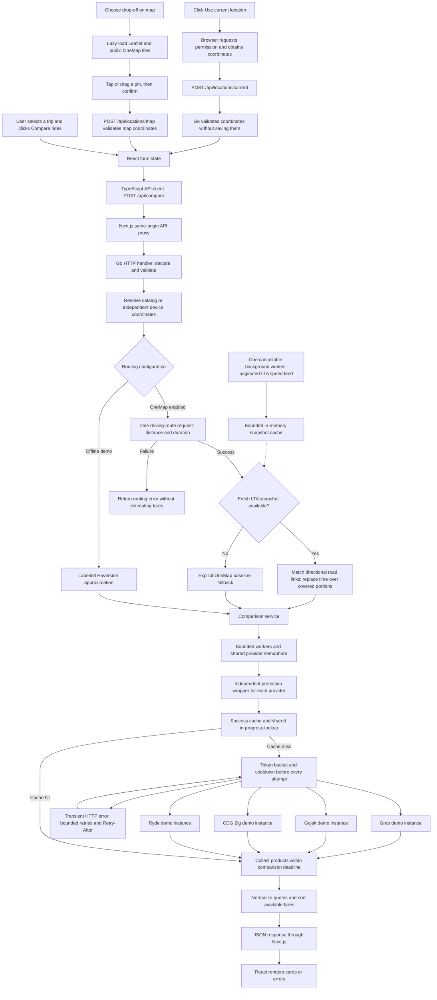

# Farewise

[](https://github.com/Raghaaavvv/farewise/actions/workflows/ci.yml)

**A Singapore ride comparison prototype built with Go, Next.js and TypeScript.**

Farewise started with a familiar problem: after landing at the airport, finding a ride home meant switching between Grab, Gojek, CDG Zig and Ryde to compare their prices. The intended app brings comparable ride options into one screen so a user can choose based on fare, pickup time and vehicle capacity.

The current prototype demonstrates the complete frontend-to-backend comparison flow using simulated providers. **Every fare, pickup estimate and availability result is invented. No provider servers are contacted, and the app cannot book rides.** A working comparison interface does not yet mean that live fare access has been solved.


[View the iPhone map picker](docs/images/map-picker-iphone.png) · [View the LTA traffic estimate](docs/images/traffic-iphone.png) · [View the observation dashboard](docs/images/observations.png)

## Observation logger: get started

Install and start [Docker Desktop](https://docs.docker.com/desktop/setup/install/mac-install/), then from the project folder run:

```bash
bash scripts/db.sh up
bash scripts/dev.sh
```

Open **http://localhost:3000/observations** or the **Observations** navigation tab. Choose the same trip used in the provider app, click **Capture trip conditions**, check the provider's displayed fare, enter its exact product, price and observation time, then save. The logger makes no requests to ride-hailing providers. Comparison fares remain simulated.

`db.sh up` creates owner-only, ignored `backend/db.env` with a generated local password, starts a PostgreSQL 17 container, binds it only to `127.0.0.1:55432`, waits for health, and preserves data in Docker's named `farewise_observation-data` volume. The backend automatically applies embedded, checksummed migrations under an advisory lock. Go 1.25+ is required by the pinned pgx driver. `dev.sh` starts the existing database when local database settings exist and loads those settings without changing your OneMap/LTA tokens. An older running backend needs a restart to expose the new routes.

## What works today

- Compare four configured demo providers: Grab, Gojek, CDG Zig and Ryde.
- Receive multiple products from one provider, with standard, premium, pool and taxi categories; filter categories without making another request.
- Display exact fares or min/max ranges, preserve useful partial data, and show each product's expiry independently.
- Choose pickup and destination from nine sample Singapore locations, or swap them.
- Use **Use current location** for pickup, or **Choose on map** for drop-off; validate coordinates through Go and preserve endpoint snapshots when swapping.
- Fetch Singapore driving distance and baseline travel time from OneMap when configured; otherwise explicitly show approximate distance with no invented driving time. Fares remain simulated in both modes.
- Optionally adjust driving time using fresh LTA Traffic Speed Bands, with route coverage, a heuristic time range, observation timestamps and explicit baseline fallbacks.
- Select one to six passengers and standard or six-seater vehicles. More than four passengers automatically selects a six-seater.
- Sort results by the lowest fare or soonest pickup.
- Explore everyday, busy-hour, rainy-day and provider-failure scenarios.
- See loading states, validation errors, retry controls, quote details and expiration notices.
- Keep healthy results visible when one provider is unavailable or times out.
- Protect each demo provider with a token bucket, a 30-second success cache, shared in-progress lookups and bounded retries.
- Bound provider evaluations across simultaneous comparisons, validate API responses at runtime, and emit structured provider logs.
- Use a responsive interface on desktop or iPhone.
- Capture immutable trip/traffic snapshots, enter real provider quotes or paid fares manually, correct observations with revision checks, inspect provider/weekday/time coverage, and export a CSV for research.

Prices are deterministic for the same inputs. Refreshing within the cache window reuses complete successful product batches and their original timestamps; cache entries expire after at most 30 seconds, or sooner when any product expires. Demo product lifetimes intentionally vary from 40 to 120 seconds. The rainy-day Gojek demo omits its pickup ETA to exercise partial data. All vehicles, tiers and service labels are illustrative, rather than verified provider products.

## Languages, frameworks and tools

| Technology | Role in the project |
| --- | --- |
| **Go** | Backend domain models, HTTP API, comparison service, concurrency and tests |
| **PostgreSQL 17 + pgx v5** | Persistent observation sessions and fare records, relational constraints, JSONB snapshots, pooled connections and parameterised SQL |
| **Docker Compose** | Reproducible, digest-pinned PostgreSQL container, local-only port, health check and persistent named volume |
| **Go `net/http`** | Method-based routing, request decoding, response handling and server lifecycle; no external Go web framework |
| **Next.js 16.4** | React App Router frontend and a same-origin proxy to the Go API |
| **React** | Components, form state, asynchronous comparison state and interactive results |
| **TypeScript** | Typed requests, responses, locations, quotes and UI state |
| **HTML, CSS and SVG** | Semantic controls, responsive layouts, icons and a sourced journey-distance summary |
| **Leaflet 1.9.4** | Lazily loaded interactive OneMap destination picker with pan/zoom, draggable pins, keyboard selection and visible attribution |
| **Python 3 (standard library)** | Optional local OneMap token setup and configuration tests; not a fare model |
| **OneMap REST API** | Optional Singapore driving-route distance, baseline duration and backend-only encoded route geometry |
| **LTA DataMall API** | Optional paginated Traffic Speed Bands snapshots, cached in memory and matched to the chosen route |
| **pnpm** | Frontend dependency management and reproducible lockfile-based installs |
| **Prettier** | Frontend source formatting |
| **Go `testing` / `httptest`** | Unit and HTTP handler tests without external test dependencies |
| **GitHub Actions** | Automatic Go checks, TypeScript checks and production frontend builds |
| **VS Code** | Workspace, recommended extensions, run tasks and a Go debugging configuration |

Observation storage uses optional local PostgreSQL. There is no account/login system, external geocoder or live ride-provider integration. Next.js forwards requests; comparison logic and observation validation/storage live in Go. This single-user prototype is intended for a trusted local machine; add authentication and access controls before exposing observation endpoints publicly.

## Architecture and request pipeline



The service starts at most four workers per comparison and uses a shared semaphore to permit at most four simultaneous `Provider.Estimate` evaluations across all comparisons on that service instance. A five-second total comparison budget includes worker queueing, semaphore waits, cooldowns, retries and adapter execution. A canceled queue does not start more provider calls; completed healthy products remain in the result.

Provider calls run directly in the workers: a permit is released only when the adapter actually exits. There is no detached goroutine that merely hides a continuing request after timeout. Adapters must honor their context internally; Go cannot forcibly terminate an arbitrary implementation that ignores it. Demo latency uses a timer selected against `ctx.Done()`, and tests exercise actual HTTP request cancellation with `http.NewRequestWithContext`, including cancellation observed by the fake server. `WithMaxConcurrentProviders(n)` configures the service limit; limits are local to that instance/process.

### How buttons reach the backend

| UI action | What happens |
| --- | --- |
| Initial page load | Fetches `GET /api/locations`, then sends the default trip to `POST /api/compare` |
| **Compare rides** | Prevents the normal form submission, captures the current trip, sends JSON, displays loading placeholders, then replaces results |
| **Use current location** | Calls browser geolocation after the click; sends latitude, longitude and accuracy to `POST /api/locations/current`; selects the returned location and asks the user to compare again |
| **Choose on map** | Opens a OneMap basemap; tap a point or choose the center, adjust the pin, then confirm through `POST /api/locations/map`; no GPS prompt or routing request occurs on confirmation |
| **Cancel location lookup** | Aborts the backend request if started, ignores late browser callbacks, and restores manual selection; it cannot dismiss the browser's own permission prompt |
| **Refresh comparison** or **Retry** | Calls the same comparison function with current form values; successful quotes are reused during the 30-second backend cache window |
| Change route, passengers, ride type or scenario | Updates local state; previous results remain visible with a notice until comparison is requested again |
| Change sort order | Reorders the existing response in the browser; does not make another provider request |
| Change vehicle category | Filters already-returned products; does not make another provider request |
| Open quote details | Displays a dialog using fields already returned by the backend |

`AbortController` cancels superseded browser requests. The UI only processes a completion if its controller has not been aborted, preventing a previous trip's response from replacing a newer comparison. Canceling a browser request does not guarantee that an upstream request has already been stopped.

The browser requests relative `/api/...` URLs. Next.js rewrites them to the Go server, avoiding the need for a separate browser-facing API origin during development.

## Software engineering skills demonstrated

### Domain modeling and object-oriented concepts in Go

Go uses **structs, methods and interfaces** rather than Java-style classes and inheritance. This project demonstrates encapsulation, abstraction, polymorphism and composition using those Go mechanisms.

| Model | Relevant fields and responsibility |
| --- | --- |
| `Location` | ID, name, description, latitude and longitude |
| `Request` | Pickup/destination IDs, passenger count, vehicle type and demo scenario |
| `Coordinates` | Optional device latitude, longitude and accuracy; missing coordinate fields are distinct from valid zero values |
| `Trip` | Resolved locations, passenger count, vehicle type, scenario, distance in km, and a sourced route summary |
| `routing.Route` | Distance in meters, nullable journey duration in seconds, source (`approximate` / `onemap`) and traffic-awareness flag |
| `routing.Router` | Injectable driving-route interface independent of ride-fare providers |
| `Quote` | Provider and product identity, category, status, currency, optional fare range and ETA, source, fetched/expiry timestamps and capacity |
| `FareRange` | `MinFare` and `MaxFare` in integer cents; equal bounds are a point fare, different bounds are a range |
| `Comparison` | Trip, collection of quotes, demo notice, collection time and expiry |
| `Service` | Encapsulates the injected providers and their timeout; coordinates comparison |
| `DemoProvider` | Holds a provider's demo configuration and implements estimation behavior |
| `ProtectedProvider` | Wraps any `Provider` with a private cache, token bucket, cooldown, in-progress lookup sharing and retry policy |
| `ProviderPolicy` | Configures request budgets, cache bounds and retry attempts for one provider |
| `ProviderHTTPError` | Carries an HTTP status and `Retry-After` from an adapter to the retry layer |

Prices use **integer cents** to avoid binary floating-point arithmetic for money. Optional fares and ETAs use pointers in Go and nullable fields in TypeScript. A missing fare is `null`; an explicitly supplied zero-price fare remains distinct and valid. Prices and ETAs must fit JavaScript's safe-integer range.

### Provider abstraction and dependency injection

```go
type Provider interface {
    ID() string
    Name() string
    Estimate(context.Context, Trip) ([]Quote, error)
}
```

The current application creates **four differently configured instances of one `DemoProvider` type**. They implement this interface and return batches of the shared `Quote` shape. Grab adds an illustrative premium tier, Zig adds an illustrative taxi range, and Ryde adds a pool tier for one or two passengers in a standard vehicle. These examples simulate fetching details; they do not fetch real app data.

A stable `(providerId, productId)` pair identifies each product. `ProductType` is a broad category, not a unique ID. A batch may contain healthy products alongside partial products, and a nonempty batch with an error preserves usable entries rather than automatically retrying the whole request. Malformed metadata and duplicate product IDs are discarded; an invalid fare or ETA can be removed while preserving the other useful field. If nothing usable remains, the provider gets an unavailable entry. `available` means fare and ETA are present, `partial` means one is missing, `unavailable` means neither can be used, and `expired` means that product's lifetime has elapsed.

`FetchedAt` is when a quote was obtained, and `ExpiresAt` is its individual validity limit. The comparison retains `collectedAt` as the oldest priced product's fetched time and `expiresAt` as the earliest expiry among priced products, including a product that expired while another adapter was running. That overall refresh hint does not invalidate longer-lived siblings: the UI checks every quote independently and removes expired quotes from recommendations. Neither cache hits nor another comparison extend a product's lifetime.

These contracts also fit a future historical-data model: `source: "model"`, product-specific ranges, and an explicit prediction lifetime. `isEstimateRange` describes unequal bounds; it does not claim a statistically calibrated confidence interval. Model versioning, feature provenance and calibration remain future work.

`main.go` wraps each demo instance using `NewProtectedProvider(provider, policy)` before injecting the wrapped list into `NewService(providers, timeout)`. Both the wrapper and underlying adapter implement `Provider`: this is the **decorator pattern through composition**. The service knows the interface rather than depending on the concrete implementation. Tests can therefore substitute a slow fake or a test-only HTTP adapter. A future permitted integration can implement the same interface with provider-specific authentication, requests and response normalization.

This uses composition and an adapter-style boundary. It does not currently contain four independently reverse-engineered provider classes.

### Separation of concerns and asynchronous programming

- **HTTP layer:** routes, JSON decoding, payload limits, validation failures and response encoding.
- **Domain layer:** location, request, trip and quote models.
- **Comparison service:** concurrency, deadlines, partial failures and result ordering.
- **Provider layer:** estimation behavior behind a shared interface.
- **Provider protection layer:** request budgets, memory cache, duplicate suppression and retry orchestration independent of fare calculations.
- **Frontend API client:** typed transport functions and error propagation.
- **UI layer:** interaction, loading states, sorting, dialogs and responsive presentation.

Other skills exercised include REST API design, JSON serialization, React hooks, dependency injection, race-aware concurrent programming, request cancellation, Git workflows and continuous integration.

### Runtime validation at the frontend boundary

`src/lib/contracts.ts` parses unknown JSON into narrowly validated UI types before state is updated. No success response is accepted merely through a TypeScript assertion. The parser checks all consumed fields, sourced route distance/duration and consistency with kilometers, nullable fares/ETAs, safe integer cents, finite coordinate ranges, recognized categories/statuses/sources, duplicate provider-product IDs, status consistency and RFC 3339 timestamp ordering. Additive unknown fields are ignored; required values are not coerced. Location catalog and current-location responses are validated too.

A malformed HTTP 200 produces an actionable invalid-response error. Malformed error bodies and non-JSON responses produce the existing unavailable-service message. The client never renders an arbitrary error object. UI helpers filter categories, handle expired products and sort ranges by their lower bound; a lowest-fare badge appears only when a product's entire range is strictly below every other fresh price in the selected category. Overlapping ranges, ties and the all-category view have no winner badge.

### Structured observability

The executable configures `slog` with a JSON handler on stderr. `provider.attempt` records each actual underlying attempt, `provider.lookup` records cache hit/miss/coalescing and total lookup latency, and `provider.result` records normalized results and invalid product counts. Fields include provider ID, duration in milliseconds, outcome, product count, error category and HTTP status when available. Logging dependencies can be injected with `WithProviderLogger` and `WithServiceLogger` for tests.

Logs omit coordinates, route IDs, cache fingerprints, credentials and arbitrary adapter error text or response bodies. Failure categories distinguish cancellation, deadlines, capacity rejection, HTTP errors and other adapter failures. These are structured logs, not a deployed metrics/tracing system.

## Coordinates and the Haversine calculation

**Haversine calculates distance between two known coordinate pairs. It does not retrieve a location or read coordinates from another app.**

`FindLocation(id)` retrieves an entry from the in-memory demo catalog. For the `current-location` ID, the backend instead validates the coordinates supplied by the browser and preserves that point without snapping it to a catalog entry. The backend converts degrees to radians and calculates the great-circle distance between pickup and destination using a spherical Earth radius of 6,371 km:

```text
a = sin²(Δlatitude / 2)
    + cos(latitude1) × cos(latitude2) × sin²(Δlongitude / 2)

distance = 2 × 6371 × atan2(√a, √(1 − a))
```

In the default offline mode, the prototype multiplies that distance by **1.25** and rounds it to one decimal place as an illustrative road-distance approximation. This factor is invented. It does not account for real roads, traffic, closures, terminal pickup arrangements or the provider's route.

Device acquisition and optional OneMap road routing are implemented; address lookup remains future work:

- **Device geolocation:** obtains the user's coordinates with permission.
- **Geocoding:** converts an address or selected place into coordinates.
- **Reverse geocoding:** converts coordinates into an address or place description.
- **Routing:** calculates a traversable road route and driving distance.

The journey summary shows numeric distance and duration with source attribution; it is not a navigation map. OneMap routing is requested once per comparison before provider fan-out. Its returned meters are divided by 1,000 without backend rounding, so every provider receives the same road distance. Display rounding does not change fare inputs. Journey duration is separate from the simulated pickup ETA. OneMap’s documented driving response does not establish live traffic awareness or guarantee the shortest route, so `trafficAware` is false.

Each endpoint has its own saved current-location snapshot. The coordinate-source IDs are `current-location` for GPS and `map-location` for a map pin; their coordinate payloads travel with the endpoint when swapping. Capturing one never overwrites the other. The interface requests GPS for pickup and lets users choose a map destination; identical coordinate pairs are rejected even if their source IDs differ. Swapping moves coordinates and saved selector options together.

With OneMap enabled, **Compare rides** sends both endpoint coordinates to OneMap. The coordinate-validation endpoint itself makes no third-party request. Coordinates are not written to disk or included in logs; the existing in-memory quote cache retains hashed trip fingerprints and quote results briefly, without raw coordinates. The interface discloses OneMap sharing before comparison. Request bodies are not placed in URL queries by the browser, but the backend-to-OneMap request follows OneMap’s documented query-parameter format.

The OneMap client has its own three-second context budget (including pacing and queueing), at most two in-flight calls and a two-calls-per-second pace per process. HTTP 429 establishes a shared `Retry-After` cooldown; later calls wait or cancel. There are no automatic routing retries and no routing-response cache. These limits do not coordinate multiple backend instances. The existing five-second provider budget begins after routing succeeds. Routing failures return 422 (unsupported/unroutable locations), 503 (token/quota), 504 (timeout) or 502 (upstream/response failures), without falling back to an approximation. Logs record routing source, latency and success without coordinates, request URLs, tokens or upstream bodies.

## Error handling and reliability

| Situation | Current behavior |
| --- | --- |
| Malformed JSON, extra fields or multiple JSON objects | HTTP 400 with an error message |
| Unknown location or identical pickup/destination | Validation failure; HTTP 400 |
| Invalid passenger count or incompatible vehicle capacity | Validation failure; the UI also selects a six-seater for more than four passengers |
| Unknown demo scenario | HTTP 400 |
| Missing or invalid device coordinates, negative accuracy, or coordinates attached to a conflicting catalog ID | HTTP 400; current-location comparisons require their coordinate payload |
| Location permission denied, lookup unavailable or timed out | Actionable message; the previous endpoint is preserved and manual selection remains available |
| Location requested from an insecure origin or unsupported browser | No device lookup is started; the UI explains the manual fallback |
| Provider returns several products or a partial response | Healthy products and useful partial fields are preserved; a whole-provider unavailable entry is used only when no valid product remains |
| Product has an invalid range or negative ETA | That field is removed; a usable sibling field can remain as partial data |
| Provider times out or is canceled | Context-aware adapter exits, its semaphore permit is released, and queued canceled calls do not start |
| API returns an error | Frontend displays the message and a retry control |
| API response cannot be parsed as JSON | Frontend displays a service-unavailable message |
| Successful HTTP response violates the runtime contract | Frontend shows an invalid-response error before updating UI state |
| Network failure | The frontend catches the rejected request and displays an error |
| Old request completes after a new request starts | Aborted request completions are ignored by the UI |
| Trip changes after comparison | Results remain associated with the previous submitted trip and an update notice appears |
| One product expires | Its card is marked expired and excluded from recommendations; later-expiring products remain usable |

The backend limits comparison bodies to 4 KB, applies server read/write timeouts, sends `Cache-Control: no-store`, and supports graceful shutdown. HTTP `no-store` prevents browser/proxy caching; it does not disable the explicit internal provider cache. Unavailable results are sorted after available prices. The outbound per-provider limits do not provide inbound abuse protection, authentication or production monitoring.

## Automated tests and continuous integration

The Go tests cover:

| Test | What it checks |
| --- | --- |
| `TestComparePartialFailureAndOrdering` | A failing Ryde adapter leaves all four providers represented, healthy products stay sorted, and the missing fare remains null |
| `TestInvalidTrips` | Rejects identical locations, five passengers in a standard vehicle, unknown locations, unexpected fields and multiple JSON objects |
| `TestTimeoutKeepsOtherProviderResult` | A timed-out provider does not discard a healthy provider's quote |
| `TestHaversineDistance` | Identical points give zero distance, one degree along the equator gives approximately 111.195 km, and distance is symmetric |
| `TestCurrentLocationValidation` | Preserves valid coordinates, accepts zero values, and rejects missing, out-of-range or non-finite values and negative accuracy |
| `TestDeviceLocationComparisonAndSwap` | Device coordinates survive validation and route swapping; conflicting IDs, missing coordinates and identical points are rejected |
| `TestCurrentLocationEndpoint` | The coordinate endpoint validates JSON, returns the device point without adding it to the shared catalog, and sets no-store |
| `TestCompareUsesActualDeviceCoordinates` | A full HTTP comparison uses the supplied coordinates and returns all four demo results |
| `TestHTTP429HonorsRetryAfterThenCachesSuccess` | A real local `httptest` server returns 429 with `Retry-After: 1`, then 200; the second request occurs at least one second later, and a repeated trip makes no third request |
| `TestHTTP429LongRetryAfterIsNotCappedToBackoff` | Integer and HTTP-date cooldowns outlast a short caller deadline, without an early retry |
| `TestHTTP429DeadlineAndCooldownProtectOtherTrips` | A 429 on the final allowed attempt still prevents another route from contacting that provider during cooldown |
| `TestHTTPRetryBudgetAndPermanentErrors` | 503 retries wait for exponential backoff and stop after three attempts; 401 is attempted once; errors are not cached |
| `TestTokenBucketBurstRefillAndProviderIsolation` / `TestEachRetryConsumesAToken` | Burst/refill behavior, cancellation, independent buckets and retries consuming tokens |
| `TestCacheKeysTTLAndCopies` / `TestCacheCapacityAndInvalidResults` | Route direction, precise coordinates, passengers, vehicle and scenario distinguish keys; expiry, LRU bounds and defensive quote copies work; invalid results are not cached |
| `TestConcurrentComparisonsCoalesceAndWaiterCanCancel` / `TestFlightCapacityAndLeaderCancellation` | Concurrent identical trips use one adapter call; cancellation and queue capacity work without keeping failed flights |
| `TestCachedComparisonKeepsOriginalFreshness` / `TestFreshThenCachedComparisonHasIdenticalExpiry` | Cached results keep their collection time and cannot extend the display expiry, including the very first refresh |
| `TestHTTPProviderCancellationReachesServer` | Parent cancellation and service deadline both cancel a real HTTP request; the fake server observes cancellation and the semaphore permit is freed |
| `TestConcurrencyLimitAcrossComparisons` / `TestCanceledQueueDoesNotStartMoreProviders` | Twelve providers across two simultaneous comparisons never exceed the configured global limit; canceled queued jobs do not call adapters |
| `TestMultipleProductsPartialDataAndErrors` / `TestQuoteNormalizationPreservesSiblings` | Multi-product responses, partial fields, partial errors, range normalization and malformed siblings do not discard healthy products |
| `TestBundleCacheHonorsShortestProductTTLAndCopies` | Whole-batch cache expires no later than the shortest product lifetime and copies nested fare/ETA values |
| `TestOneMapDrivingRouteContract` / `TestOneMapInvalidResponsesAndErrors` | Driving query/authentication and response parsing, missing fields, no route, malformed JSON, token and server failures |
| `TestOneMapCancellationReachesHTTPServer` / `TestOneMapDeadlineWhileReadingResponse` | Canceling a real outbound request is observed by the local fake server and frees the routing permit; deadlines while reading a streamed body remain timeouts |
| `TestOneMap429AppliesSharedCooldown` / `TestOneMapPacingAndCancellationBeforeRequest` / `TestOneMapConcurrencyLimitAndCanceledQueue` | Quota cooldown and request pacing block subsequent calls while respecting caller cancellation |
| `TestRoadDistanceFlowsToEveryProvider` / `TestRoutingFailureDoesNotUseApproximateFare` | A single route feeds all four providers; routing errors prevent fare evaluation instead of hiding failures behind demo distance |
| `TestInvalidTripsAndLocationCaptureDoNotCallRouter` | Validation failures and coordinate capture do not make external routing requests |
| `TestMapLocationEndpointAndComparison` / `TestInvalidMapLocationBodies` / `TestMapPointValidationAndSwap` | Confirmed map-source metadata, full coordinate precision, bounds/JSON validation, comparison use and swap behavior |
| `TestStructuredProviderLogs` | Logs contain latency, outcome and cache fields without adapter secrets or route data |

The three Python setup tests reject malformed/expired authentication responses, prevent token injection into the shell-sourced environment file, preserve unrelated settings and verify owner-only file permissions. Run `python3 -m unittest discover -s scripts/tests`; no real credentials or API calls are used.

Run all local checks:

```sh
bash scripts/check.sh
```

This runs the local Python token-setup tests, Go tests with the race detector, `go vet`, frontend location/API unit tests, TypeScript checks and a production Next.js build. GitHub Actions runs the equivalent checks on pushes and pull requests. The Go workflow checks both the supported minimum version and the current development version.

The 37 frontend tests cover synthetic geolocation and coordinate requests, runtime response validation (including malformed successful responses), category filtering, product identity, missing ETAs, range display, overlapping ranges, per-product expiry, independent endpoint capture/swapping, map bounds/precision/provenance, map-confirmation cancellation and routing/traffic contract validation (including contradictory coverage and ranges), exact-cent observation parsing, Singapore timestamps, immutable snapshot provenance, quality flags and malformed-save rejection. Run them with `pnpm test` from `frontend/`. They do not read anyone's real location or display a real permission prompt.

TypeScript checking and a production build are static/build checks. Domain helpers and API boundaries have behavioral unit tests, but a repeatable full browser suite remains a future improvement. Category filtering, multiple products, partial ETA display and product expiry were also checked in the local browser, along with a 390-pixel iPhone layout with no horizontal overflow. The current screenshots show the interactive destination picker and a comparison using real OneMap route distance/time with simulated fares. The map dialog and journey summary are checked at a 390-pixel iPhone width without horizontal overflow.


## Challenges and problems identified so far

### 1. Obtaining each provider's live price

The main unresolved problem is obtaining permitted, reliable live fare data for all four providers. A route-distance formula cannot reproduce demand-based prices, personal promotions, vehicle availability or provider-specific fees.

Grab publishes a [Farefeed API](https://developer.grab.com/products/farefeed-api) for selected partners, with [documented fare estimates](https://developer.grab.com/docs/partner-farefeed/). Access and Singapore coverage for this project still need confirmation. Ryde's [published merchant API](https://developer.ryde.io/) covers RydeSEND deliveries, which does not establish passenger fare access. No self-service Singapore passenger-fare API was verified for Gojek or CDG Zig during the initial research.

**Current decision:** develop the comparison flow with transparent simulated adapters, then replace them when suitable access is available. Future quote models must support fare ranges, account-specific pricing, inclusions, source and provider expiry before displaying real data.

### 2. Obtaining location and other attributes

Permission to access the user's device location is different from permission to access data inside a ride-hailing app. The prototype now supports optional device location, while provider-app data access remains unresolved.

**Use current location** invokes `navigator.geolocation.getCurrentPosition()` only after a click. The browser manages permission; an already-granted permission may not produce another prompt. The server cannot request device permission or read GPS directly. After permission succeeds, latitude, longitude and accuracy are sent in a POST body to this app's backend, which validates them and returns a `Current location` value. Ordinary comparison coordinates stay out of the observation database and are not sent to ride providers. Explicitly capturing a trip in the logger stores its coordinates and features locally in PostgreSQL. The “Log a real fare” link carries a temporary trip draft in browser session storage until the dashboard opens; that draft is not a saved observation. When OneMap routing is enabled, comparing forwards both endpoint coordinates to OneMap for the route calculation. The comparison cache retains a hashed route fingerprint and a quote, without raw coordinates, in bounded process memory. Hashing is not a guarantee of anonymization. The UI preserves manual selection after errors and ignores canceled lookups.

Browser geolocation requires a secure context: localhost works for development, while iPhone access over the plain-HTTP LAN URL does not support this feature. Use HTTPS for phone geolocation; manual sample-location selection continues to work over the LAN URL. No reverse geocoding is performed, so the selected point is labelled **Current location**, rather than a street address. See [MDN's Geolocation API documentation](https://developer.mozilla.org/en-US/docs/Web/API/Geolocation_API).

Provider-specific pickup points, service names, ETAs and availability require a suitable provider integration. On iPhone, another app's private data is also protected by [iOS sandboxing](https://support.apple.com/en-au/guide/security/sec15bfe098e/web).

### 3. Respecting provider rate limits

A timeout limits how long a request takes; it does **not** limit how often requests are sent. `ProtectedProvider` now applies these rules before contacting each underlying demo adapter:

| Setting | Demo default and behavior |
| --- | --- |
| Token bucket | 2 attempts/second, burst of 2; every attempt, including retries, needs a token |
| Success cache | Complete, valid available batches only; expires at the earlier of 30 seconds from completion or the shortest product expiry; partial/error batches are not cached |
| Cache key | Directional route IDs and precise coordinates, passenger count, vehicle type, plus scenario, distance, route source and duration; route provenance prevents reusing quotes across different feature inputs; each provider has its own namespace |
| Memory bounds | 256 entries per provider with least-recently-used eviction; expired entries are removed on subsequent lookups; no disk persistence |
| Duplicate suppression | Concurrent callers for the same key share one in-progress lookup rather than spending separate tokens |
| Request capacity | At most 64 distinct in-progress cache misses per provider, including queued calls and retries; excess requests return an unavailable result |
| Retry budget | At most 3 attempts total for an empty failed batch; only typed HTTP 429, 502, 503 and 504 errors are retryable; nonempty partial/error batches are preserved without retrying |
| Backoff | Capped exponential delay of 200 ms, 400 ms, then up to 1 second, with equal jitter between half and all of each delay; three attempts require at most two retry waits |
| `Retry-After` | Integer seconds or HTTP-date; wait for at least the greater of the header delay and jittered backoff; malformed headers fall back to backoff |
| Shared cooldown | A 429, or a retryable error carrying `Retry-After`, pauses new attempts for that provider, including different routes; already-started calls cannot be recalled |
| Cancellation | Token waits, retry waits and coalesced waits honor context cancellation; the comparison's five-second budget includes all waits |

`Retry-After` is **never shortened to the backoff cap**. A provider asking for a 60-second pause causes a five-second comparison to time out rather than retry early, while the provider-wide cooldown stays in effect. A cache hit spends no token, can be served during cooldown, and preserves each quote's original `fetchedAt` and `expiresAt`; the response's `cached` field identifies actual cache reuse. Sharing an in-progress result is not marked as a cache hit.

Read the implementation in this order: `DemoProviderPolicy` and wiring in `cmd/server/main.go`; `ProtectedProvider.Estimate` for caching and coalescing; `waitForToken` for budget/cooldown; `estimate` for retry orchestration; `ProviderHTTPError` and `ParseRetryAfter` for the future HTTP adapter contract. The test-only HTTP adapter closes response bodies and uses a context-aware request against `httptest`, never a real ride service.

The first caller owns a shared lookup's context. If it cancels, waiting callers receive that cancellation and may explicitly try again; canceling only a waiting caller leaves the underlying lookup running. Cached pointer fields are copied so a caller cannot mutate the stored price. Cache expiry is enforced on read; expired entries can remain in memory until another lookup or process exit, subject to the entry bound.

These are learning defaults, **not provider-approved quotas**. Before a live integration, configure the documented budget and cache permissions, scope caches to account/currency/region where needed, respect provider quote expiry and allowed retention, and coordinate limits across multiple server processes. An actual HTTP adapter must return `ProviderHTTPError` to opt into retry behavior. The decorator does not retry bookings, discover private endpoints or bypass access controls.

### Possible estimation-first direction

[RideGuru describes](https://ride.guru/content/about/faq) an algorithm using rates, route duration/distance and other travel factors, calibrated with submitted fares. Farewise could add a separately labelled algorithmic estimate provider behind the same `Provider` interface, with approved live quotes added later. That would need sourced fare rules or a lawful calibration dataset, uncertainty ranges, and validation against held-out trips. The current Haversine road factor and invented demo constants are not a calibrated model and cannot establish the cheapest app in real time.

### 4. Platform restrictions and access controls

Private endpoints may depend on login state, expiring tokens, signed requests, certificate pinning or device checks. A captured request does not establish that it can be reused reliably or that the provider permits that use. These restrictions can also change between app releases.

**No restriction bypass, certificate-pinning bypass, credential extraction or private-endpoint scraping is implemented in this repository.** The intended integration path is a documented API, approved partner access or another explicitly permitted mechanism. Public comparison use must be checked against the applicable provider terms; being a personal, noncommercial project does not establish permission.

### 5. Making fares genuinely comparable

A useful comparison must match pickup point, passenger capacity, product type, currency, collection time and fee treatment. A fixed price, metered estimate and estimated fare range cannot be treated as identical products. Airport surcharges, ERP, platform fees, discounts and stale quotes can alter the final result.

**Current limitation:** demo totals are invented. Actual fee accounting, personal promotions and apples-to-apples product mappings remain future work.

### 6. Local development file watching

The original Next.js development watcher could not start its native macOS file-event stream in this workspace. Switching the development server to Webpack and enabling polling resolved the local startup problem. Production builds also use Webpack. This is a development-environment workaround, not a provider-data solution.

## Run locally

Install **Go 1.25+**, **Node.js 20.9+** (a supported LTS version is recommended), and **pnpm 11.25.0**.

```sh
git clone https://github.com/Raghaaavvv/farewise.git
cd farewise/frontend
pnpm install --frozen-lockfile
cd ..
bash scripts/dev.sh
```

Open **http://localhost:3000**. The script starts both servers; Ctrl+C stops them. Frontend changes reload automatically. Restart the script after editing Go code. The helper script can use the project-local runtimes on the original development machine; those runtimes are not committed and are not required when ordinary system tools are installed.

To run each component independently:

```sh
# Terminal 1, in backend/
go run ./cmd/server

# Terminal 2, in frontend/
pnpm dev
```

Open `Farewise.code-workspace` in VS Code, or open the project folder. Use **Terminal → Run Task → Start Farewise**. The Go debug configuration additionally requires the Go extension, Go on PATH and its Delve debugger. Format the frontend with `pnpm format` from `frontend/`.

Official installation references: [Go](https://go.dev/doc/install), [Node.js](https://nodejs.org/en/download), [pnpm](https://pnpm.io/installation), [Next.js](https://nextjs.org/docs/app/getting-started/installation).

### Try it on iPhone

Connect the Mac and iPhone to the same trusted Wi-Fi network. Start both servers using `bash scripts/dev.sh --hostname 0.0.0.0`, then open `http://YOUR-MAC-LAN-IP:3000` in Safari. Stop any already-running instance first. Safari's **Share → Add to Home Screen** can create an app shortcut.

This exposes the development frontend to the local network. The Go API can remain on loopback because Next.js proxies API requests. Default startup binds to loopback. Offline operation and a service worker are not implemented.

### Configuration

| Setting | Default | Purpose |
| --- | --- | --- |
| `FAREWISE_ADDR` | `127.0.0.1:8080` | Go API listening address |
| `DATABASE_URL` | unset | Backend-only PostgreSQL connection string. `dev.sh` loads generated `backend/db.env`; unset disables the observation API without affecting comparison |
| `API_BASE_URL` | `http://127.0.0.1:8080` | Next.js server-side API proxy target; set before startup |
| `FAREWISE_ROUTING_PROVIDER` | `approximate` | `approximate` uses offline demo distance; `onemap` requests Singapore driving routes |
| `ONEMAP_TOKEN` | unset | Backend-only OneMap access token, required in `onemap` mode |
| `FAREWISE_TRAFFIC_PROVIDER` | `off` in template | `lta` enables the background speed collector; requires OneMap. If absent, a configured LTA key enables traffic automatically |
| `LTA_ACCOUNT_KEY` | unset | DataMall **API** account key sent in the `AccountKey` header; separate from OneMap and any SDK key |
| `WATCHPACK_POLLING` | `1000` during development | Polling interval in milliseconds |

No ride-provider keys are required. Routing defaults to offline mode and makes no OneMap requests. Backend startup fails clearly when `onemap` is selected without a token or a routing mode is misspelled. Never use a `NEXT_PUBLIC_` variable for tokens.

### Enable free OneMap driving routes

[OneMap’s official workshop material describes its APIs as free to use](https://www.onemap.gov.sg/apidocs/static/media/OneMap_API_Workshop_Presentation_260825.04f72136081dd249c5ee.pdf), with token-based call quotas.

1. Register through [OneMap’s API documentation](https://www.onemap.gov.sg/apidocs/). For this personal project, choose **Others**, **Website**, and describe the map selection and driving-distance use.
2. If registration provides a token, copy `backend/.env.example` to `backend/.env` (unless the local file already exists), set `FAREWISE_ROUTING_PROVIDER=onemap` and `ONEMAP_TOKEN`, and keep the file private. It is ignored by Git.
3. To generate or renew a token instead, run `python3 scripts/setup-onemap.py`. The command asks for registered credentials in your own terminal, hides the password, calls the HTTPS [authentication endpoint](https://www.onemap.gov.sg/apidocs/authentication), and atomically saves only the token to `backend/.env` with owner-only file permissions. It does not print the token or save your email/password. Other configuration fields are preserved.
4. Restart `bash scripts/dev.sh`. This script reads `backend/.env`; a direct `go run ./cmd/server` requires you to export the variables yourself.
5. Compare two different, road-accessible Singapore points. The summary should change to **Driving distance**, show journey time, and attribute OneMap / Singapore Land Authority. Simulated fares now use that road distance.

OneMap tokens expire after three days and do not automatically renew. Generate a new token, update the local file and restart when access expires. The local setup command stores only the token; account passwords are not retained and background renewal is not implemented. See the [driving-route API](https://www.onemap.gov.sg/apidocs/routing) for the request/response contract. An authenticated live sample route was verified on 14 October 2026: the Changi-to-Orchard catalog route returned 23,570 meters and 1,883 seconds. These are example responses, not guaranteed values for future queries. Both catalog and map-selected endpoints were tested through the live routing adapter; fares remained simulated. Local HTTP-server tests continue to cover error and cancellation behavior. Before reusing routing content in a future training dataset, review the chosen data source’s applicable reuse terms.

### Interactive map selection

The [official OneMap basemap example](https://www.onemap.gov.sg/docs/maps/index.html) supplies public tiles without a token. Leaflet is dynamically imported only when **Choose on map** opens. The picker preserves OneMap’s required logo and links, supports tap/drag selection and keyboard panning with **Use map center**, and validates OneMap’s published viewing bounds in both TypeScript and Go. The bounds are a viewing rectangle, not an exact national border; the routing API determines road accessibility.

Confirmation validates the coordinate pair through `POST /api/locations/map`, with source `map`, ID `map-location`, and `persisted: false`. Canceling closes the dialog without changing the trip; pending requests and map listeners are cleaned up. Coordinates are preserved at full precision and rounded only in the display. This version uses a **Pinned location** label and does not resolve a street address or implement text search. Address lookup will require a separate token-backed OneMap service.

Basemap display and road routing are separate: the map picker works without an access token, while driving distance/time requires the backend token. In approximate mode the map is real, but the journey distance is still explicitly an approximation and fares are simulated.

### LTA traffic-adjusted driving time

Register for a DataMall **API account key** at [LTA API access](https://datamall.lta.gov.sg/content/datamall/en/request-for-api.html). Keep a separately issued SDK key separate. Add these settings to ignored `backend/.env`, then restart `bash scripts/dev.sh`:

```dotenv
FAREWISE_ROUTING_PROVIDER=onemap
ONEMAP_TOKEN=your-local-onemap-token
FAREWISE_TRAFFIC_PROVIDER=lta
LTA_ACCOUNT_KEY=your-local-api-account-key
```

The backend uses `GET https://datamall2.mytransport.sg/ltaodataservice/v4/TrafficSpeedBands`, with the key only in the HTTPS `AccountKey` header. The [LTA API guide](https://datamall.lta.gov.sg/content/dam/datamall/datasets/LTA_DataMall_API_User_Guide.pdf) documents a five-minute update interval and 500-row pagination using `$skip`. The live feed mixes numeric strings and numbers, and pages may have different `lastUpdatedTime` values; the parser handles both numeric forms and page-specific Singapore timestamps.

One worker starts when the configured backend starts, collecting at most 300 pages / 150,000 rows with up to four overlapping page requests and a **shared** 200 ms minimum between request starts, a five-second timeout per HTTP attempt and a 120-second collection budget. These are our own application limits, not a claim about LTA's allowed quota. Page zero is fetched first; larger feeds use a bounded four-page window. Responses are consumed in page order, and the first short page ends collection. At most three higher pages may be prefetched and canceled. Out-of-order buffering is also bounded to the window. Failed or incomplete collections are never published. Transient transport errors or HTTP 500/502/503/504 receive at most one retry of that page, using the same shared pacer and a 300–500 ms jittered delay. Responses asking for `Retry-After` are not immediately retried. A failed page is retried in place; successfully downloaded pages are kept in the pending collection. At most 600 HTTP attempts are possible within the original 120-second budget. The worker respects `Retry-After`, waits at least one minute after failed collections, never forwards credentials across redirects and cancels on server shutdown. Comparisons do not wait for collection: while warming up they return OneMap's baseline with an explicit traffic status. No separate scheduled task or persistent collector runs after the backend stops.

Only valid page observations younger than ten minutes are collected. When collection finishes, observations older than eight minutes are discarded to leave at least two minutes of freshness for use. Duplicate road IDs prefer newer page observations. A complete collection replaces the previous immutable snapshot, kept only in bounded process memory for at most five minutes or until its oldest retained observation reaches ten minutes. The worker starts refreshing up to two minutes before snapshot expiry while comparisons can still use the previous valid snapshot. Expired observations are never used to adjust time. The reported `observedAt` is the **oldest retained page observation**, not a per-road measurement timestamp. Refresh gaps and source failures can therefore produce baseline results. No traffic history, route geometry or user coordinates are saved to disk. Matching is bounded by two million grid entries and 20,000 route samples per comparison.

The prototype estimates time over **OneMap's chosen route**; it does not search for a faster route:

1. Decode OneMap's precision-5 polyline internally and check its geometric length against reported road distance.
2. Index LTA road links into a bounded spatial grid. Sample the route at intervals no longer than 25 m, matching a nearby link within 30 m, with direction cosine at least 0.85 and projection within the link's endpoints.
3. Scale sampled distances to OneMap's reported distance. Use the band midpoint for the point estimate and band endpoints for a heuristic range. A 2 km/h floor keeps zero-speed lower bounds finite; this is a crawl-speed assumption, not a measured queue-delay model.
4. Replace the baseline time assigned to matched route portions; retain baseline time for unmatched portions. Do **not** add a whole expressway's duration to the existing total. Baseline time is apportioned uniformly by distance because segment-level baseline times are not available in the current adapter.
5. Apply the adjustment only when at least 20% of route distance has a fresh directional match. Below that threshold, use the baseline and expose insufficient coverage.

The response adds `trip.route.traffic`: source/status, baseline and adjusted seconds, min/max seconds, coverage, matched distance/link count, timestamps and a message. `durationSeconds` contains the adjusted point estimate only when `trafficAware=true`; otherwise it retains the baseline. Geometry remains backend-only. Frontend runtime validation checks coherent ranges, provenance, timestamps and coverage before rendering.

**Accuracy limits:** nearest-link matching can confuse nearby parallel roads, and speed bands do not model all signals, junction queues or future traffic changes. The range is not a statistical confidence interval. Coverage is a matching metric, not validated accuracy. This is an uncalibrated traffic-time estimator and must be evaluated against observed trip durations before claiming accurate ETAs. Fare formulas and pickup ETAs remain simulated and do not yet use a trained model.

Tests exercise pagination, mixed number formats, shared refreshes, expiry, per-page freshness, bounded concurrency, globally shared pacing, out-of-order completion, in-place transient page retry, 429 cancellation/cooldown, redirect protection, real HTTP cancellation and worker shutdown. Geometry tests reject reverse-direction, crossing, distant and sparse links, verify covered-time replacement without double counting, and check finite crawl-speed bounds. API tests verify adjusted time reaches every provider and the comparison response; frontend tests reject contradictory traffic contracts.

An authenticated public sample was verified on **14 October 2026**: the Changi-to-Orchard route was 23.57 km, with a OneMap baseline of 1,883 s. LTA matched approximately 77.5% / 191 road links and yielded a point estimate of 1,789.1 s (29.8 min), with heuristic bounds of 1,653.0–1,977.0 s (27.6–33.0 min). Two cached-snapshot comparisons took approximately 0.57 s and 0.13 s on this development machine; these are sample observations, not a load-test benchmark or guaranteed future values. All fare sources remained `simulated`. The original sequential collector took approximately 81–103 seconds in this environment. After bounded concurrency was added, two live checks collected 288 pages / 143,787 rows in approximately **59.1 s** and **62.4 s**, under the same 200 ms shared request-start policy. One earlier attempt hit a late transport timeout; transient pages now get one in-place retry. These are separate sample runs, not a controlled load-test benchmark. At five starts per second, 288 pages impose a pacing floor of roughly 57 seconds even with ideal overlap. The UI still offers baseline time while warming.

### Future traffic sources

Estimated expressway travel times and traffic incidents remain future additions; no fabricated incident delay is added now. [Traffic Images](https://data.gov.sg/datasets/d_6cdb6b405b25aaaacbaf7689bcc6fae0/view) remain unintegrated: camera images require additional processing to become congestion features. No forecasting model has been built. The observation dashboard can now collect a private calibration dataset; actual manual observations are required before claiming prediction accuracy.

## Observation data and research workflow

### Storage and timing

Two tables separate captured context from manual labels:

- `observation_sessions`: UUID, capture timestamp, request fingerprint and JSONB snapshot containing the resolved trip, route/traffic provenance, area labels, simulated reference quotes and feature/formula versions. Geometry is excluded. Snapshots are immutable.
- `fare_observations`: UUID, session foreign key, provider, exact product, integer-cent fare, displayed-quote/paid-fare distinction, observation timestamp, reported weather/promotion, optionally known included fees, notes, revision and creation/update timestamps.

A session can have several providers' observations, each with its own timestamp. “Capture fresh conditions” creates a new session even when the route is unchanged. Network retries reuse the pending request's UUID and fingerprint, so retrying a successful-but-lost response does not create a duplicate. Reusing an ID with different details returns 409. Corrections increment a revision and reject stale edits; they preserve session linkage and the original snapshot. Fare corrections do not retain a full change-history audit log yet.

The server validates coordinates/route inputs, required fields, finite values, integer cents, supported categories, included fees and future dates. It stores timestamps in UTC and derives weekdays/time buckets in Singapore time. The dashboard always identifies its date/time input as SGT, regardless of the device's timezone. Weather and area types are manual labels; no weather or land-use feature retrieval has been implemented.

`contextAligned` requires capture at most one minute after or five minutes before the fare observation. `trafficFreshAtQuote` separately checks the captured LTA observation/expiry against that fare time. Backdated entries remain saved, with mismatches flagged; current traffic is never presented as historical traffic. `trainingEligible` is only a coarse candidate flag for a displayed quote, time alignment and an actual OneMap road route. It does not guarantee accuracy, complete features or adequate dataset coverage. Paid fares remain separate, promotions may need filtering, and missing traffic stays explicit.

### Dashboard, export and backups

The dashboard shows collection counts, distinct coordinate/passenger/vehicle routes, provider/weekday/time coverage, provider/search filters and 20-row history pages. Coverage summaries describe the whole collection; the table and export use the selected filters. Corrections leave captured conditions fixed. Reusing a saved route requires capturing fresh conditions before a new fare.

CSV export contains observation/session IDs for grouping, actual fare cents, quote/paid distinction, UTC/SGT times, endpoints, manual area/weather labels, road distance/duration, original baseline, traffic provenance/coverage/expiry, quality flags, feature versions and separately identified demo fare/scenario columns. Exports are limited to 10,000 matching entries per file. User-entered text that could become a spreadsheet formula is escaped. Demo prices remain reference/debug data, not a verified provider base fare or a surge label. No automatic multiplier is learned from two examples.

Database credentials, backups and exports are ignored by Git. No real observation data is included in the public repo or project ZIP. Docker volumes survive ordinary container stops/recreation; **do not remove the data volume to reset the app**. Keep backups of your own collection:

```bash
bash scripts/backup-db.sh   # owner-only custom-format backup of the public schema
bash scripts/db.sh status
bash scripts/db.sh stop    # stops PostgreSQL while preserving the volume
bash scripts/db.sh up      # starts it again
bash scripts/db.sh shell   # opens psql inside the container
```

The backup helper creates a private file under ignored `backups/`. Restoring a backup should be an explicit separate operation; no automatic destructive restore/reset command is included. Changing the generated password after PostgreSQL initialisation does not automatically rotate the database role's password.

### Implementation and verification

`POST /api/observation-sessions` resolves the trip through the same routing/traffic pipeline used by comparison, captures simulated reference products and saves the server-generated snapshot. No feature values supplied by a browser are accepted as authoritative routing data. `POST /api/observations` saves only manually reported fare fields linked to a saved session. Read/edit/export operations use parameterised SQL, bounded context deadlines and a four-connection pool. Database errors are sanitised; application logs never include prices, coordinates, database URLs or credentials. JSON mutations validate content type and browser origin.

Read the backend in order: `internal/observations/models.go` (contracts/validation/quality), `migrations/001_observations.sql` (schema), `postgres.go` (migration and repository), `internal/api/observations.go` (HTTP flow), `csv.go` (research export). The client lives in `src/lib/observations.ts`; `src/app/observations/page.tsx` renders the dashboard. PostgreSQL/Docker are required for persistence, while the comparison-only app continues to work with `DATABASE_URL` unset.

Run database tests separately:

```bash
bash scripts/test-db.sh
```

These tests use unique temporary PostgreSQL schemas and remove only their own fixtures. They verify migrations, immutable snapshots, duplicate/replayed/concurrent saves, optimistic corrections, search parameterisation, statistics and reconnection persistence. Unit/HTTP tests cover validation, source provenance, timing, CSV escaping, content type/origin checks and credential-safe errors. CI has a real PostgreSQL service in addition to Go race/vet, frontend tests/type checks and production builds. Browser verification uses an isolated test schema and explicitly synthetic fares, leaving the real collection empty.

Two weeks is an initial collection period, not a guarantee of sufficient training data. Collect matched products on repeated routes across time slots, weekdays/weekends and conditions. Keep related observations grouped by session when splitting data, evaluate on later days, and hold out routes before claiming generalisation to unseen trips. Start by analysing real fares and observed reference fares; a model should predict the actual quote instead of fitting an arbitrary multiplier to demo coefficients.

## API contract

| Method | Endpoint | Response |
| --- | --- | --- |
| GET | `/api/health` | Service health and demo mode |
| GET | `/api/locations` | Sample locations, coordinates and `routingSource` for disclosure |
| POST | `/api/locations/current` | Validated device location, source `device`, and `persisted: false` |
| POST | `/api/locations/map` | Validated map coordinates, source `map`, ID `map-location`, and `persisted: false` |
| GET | `/api/observations/status` | Local PostgreSQL configuration status |
| POST / GET | `/api/observation-sessions` / `/api/observation-sessions/{id}` | Capture and read a server-generated trip snapshot |
| POST / GET | `/api/observations` | Save manual fare fields or list filtered records and coverage |
| PUT | `/api/observations/{id}` | Revision-checked fare correction without replacing its snapshot |
| GET | `/api/observations/export` | Filtered CSV export with provenance and quality flags |
| POST | `/api/compare` | Resolved trip, quotes, source notice and timestamps |

Example comparison request:

```json
{
  "pickupId": "changi-t3",
  "dropoffId": "orchard",
  "passengers": 1,
  "rideType": "standard",
  "scenario": "normal"
}
```

`rideType` accepts `standard` or `six`; `scenario` accepts `normal`, `busy`, `rain` or `outage`. Invalid inputs return HTTP 400 with an `error` field. Valid comparisons return HTTP 200 with a flat array containing potentially multiple products per provider. Partial products have a nullable fare or ETA; unavailable products have both null.

The internal API now replaces `amountCents` with `fare` and quote-level `collectedAt` with `fetchedAt`/`expiresAt`. Frontend and backend must be updated together. Example fare shapes in cents:

```json
{
  "pointFare": { "minFare": 1800, "maxFare": 1800, "isEstimateRange": false },
  "rangeFare": { "minFare": 2200, "maxFare": 2600, "isEstimateRange": true }
}
```

These two illustrative shapes show the value of a quote's `fare` property, not extra top-level response fields. Each quote also includes `productId`, `productType`, `fetchedAt` and `expiresAt`; the comparison's own timestamps remain separate.

For a device pickup, use `pickupId: "current-location"` and add `pickupCoordinates: { "latitude": 1.36, "longitude": 103.989, "accuracyMeters": 12 }`. These example values are synthetic. For a device drop-off, use `dropoffId: "current-location"` and `dropoffCoordinates` instead. Both endpoints may use the same reserved ID with separate, different coordinate payloads. Accuracy is optional; latitude and longitude are required. Never attach coordinates to a catalog ID.

## Project structure

```text
backend/
  cmd/server/main.go          HTTP startup, configuration and shutdown
  internal/api/               Routes, JSON handling and handler tests
  internal/fare/              Models, adapters, service and domain tests
  internal/observations/      Models, PostgreSQL repository, SQL migration, CSV and tests
  internal/routing/           OneMap geometry, LTA snapshot worker, traffic estimator and tests
  .env.example                Backend-only routing configuration template
frontend/
  src/app/                    Next.js page, layout and responsive styles
  src/components/             Icons and sourced route-distance summary
  src/lib/api.ts              Validated transport functions and fare formatting
  src/lib/contracts.ts        Response types and narrow runtime parsers
  src/lib/quote-view.ts       Category, ordering, range and expiry helpers
  src/lib/trip-location.ts    Coordinate-source snapshots, swapping and equality
  src/lib/map-selection.ts    OneMap bounds and display-only coordinate formatting
  src/lib/geolocation.ts      Browser permission and location-error handling
  tests/                      Geolocation, API contract and quote behavior tests
  next.config.ts              Same-origin proxy and watcher configuration
.github/workflows/ci.yml      Automated checks on GitHub
.vscode/                     Recommended extensions, tasks and debugger
scripts/                     Startup, toolchain lookup, local token setup and verification
docs/images/                Desktop and iPhone screenshots
Farewise.code-workspace      Portable VS Code workspace
```

For a code review, follow a request through these files:

1. `backend/internal/fare/models.go` defines the trip, quote and provider data. `service.go`, `providers.go` and `protection.go` then validate trips, generate demo products and protect provider calls.
2. `backend/internal/routing/onemap.go`, `lta.go` and `traffic_estimate.go` resolve a driving route and enrich its duration with available traffic data.
3. `backend/internal/api/handler.go` decodes comparison requests and joins the route and fare services. `observations.go` handles capture, save, edit, list and export requests.
4. `backend/internal/observations/models.go` defines manual-fare input and quality flags; `postgres.go` stores records and snapshots; `csv.go` produces the export.
5. `frontend/src/lib/contracts.ts` and `observations.ts` validate backend responses. The pages under `frontend/src/app/` manage trip selection and the observation dashboard.

Go files use `gofmt`; frontend files use Prettier. The applied observation SQL migration is checksummed by the database, so later schema changes should use a new migration instead of reformatting that file.

## Next steps

- [ ] Confirm permitted passenger-fare access and comparison-use rights for each provider.
- [ ] Implement a live adapter, beginning with one provider, and validate it against actual app quotes.
- [x] Support batches, stable product IDs, fare ranges, partial fields and per-product expiry.
- [ ] Map actual provider fee inclusions and product names; add model/feature version provenance.
- [x] Add optional device geolocation with permission, validation, cancellation and manual fallback.
- [x] Integrate optional OneMap driving-route distance and duration with context cancellation and fake HTTP-server tests.
- [x] Add optional LTA speed-band collection, directional route matching and transparent traffic-time ranges against synthetic HTTP servers.
- [x] Configure a local OneMap token and verify authenticated catalog and map-selected routes.
- [x] Add an interactive OneMap destination picker with coordinate validation, cancellation and attribution.
- [ ] Add manual address search and geocoding.
- [ ] Add secure token renewal and a routing-cache policy after reviewing data reuse terms.
- [x] Implement provider-specific rate limiting, bounded retries and a bounded short-TTL demo cache; test 429 behavior with a fake HTTP server.
- [ ] Evaluate a calibrated algorithmic estimate provider, clearly separated from live quotes and demo prices.
- [x] Bound provider concurrency and prove context cancellation with a real fake-server HTTP call.
- [x] Add runtime API response validation and structured provider logs.
- [x] Add Docker/PostgreSQL observation capture, manual fare logging, corrections, CSV and database CI tests.
- [ ] Add full browser interaction tests.
- [ ] Add deployment configuration, authentication where needed and operational monitoring.

Farewise is a personal learning project and is not affiliated with Grab, Gojek, CDG Zig or Ryde. The repository contains a prototype, not a production ride-booking service.
